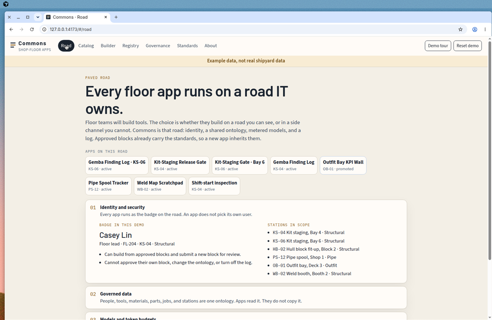
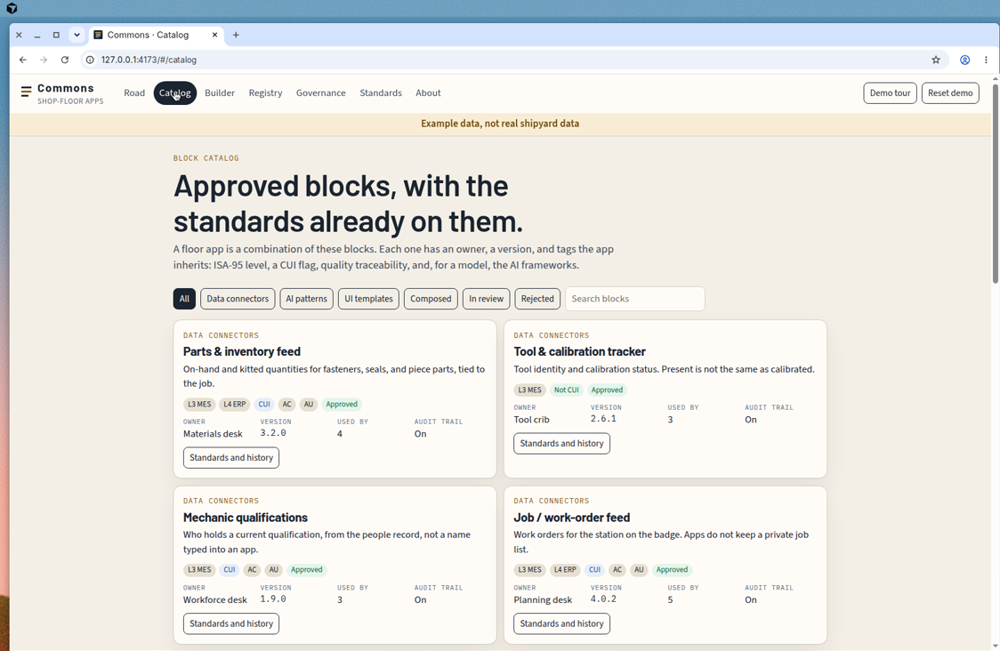
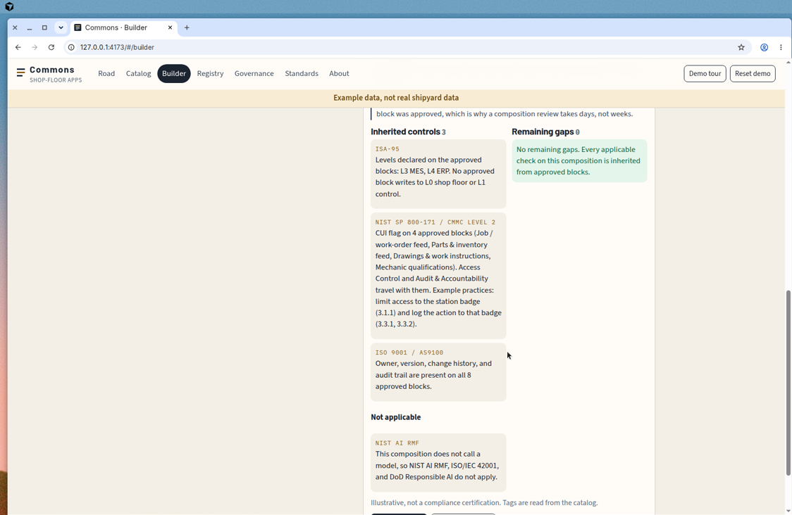
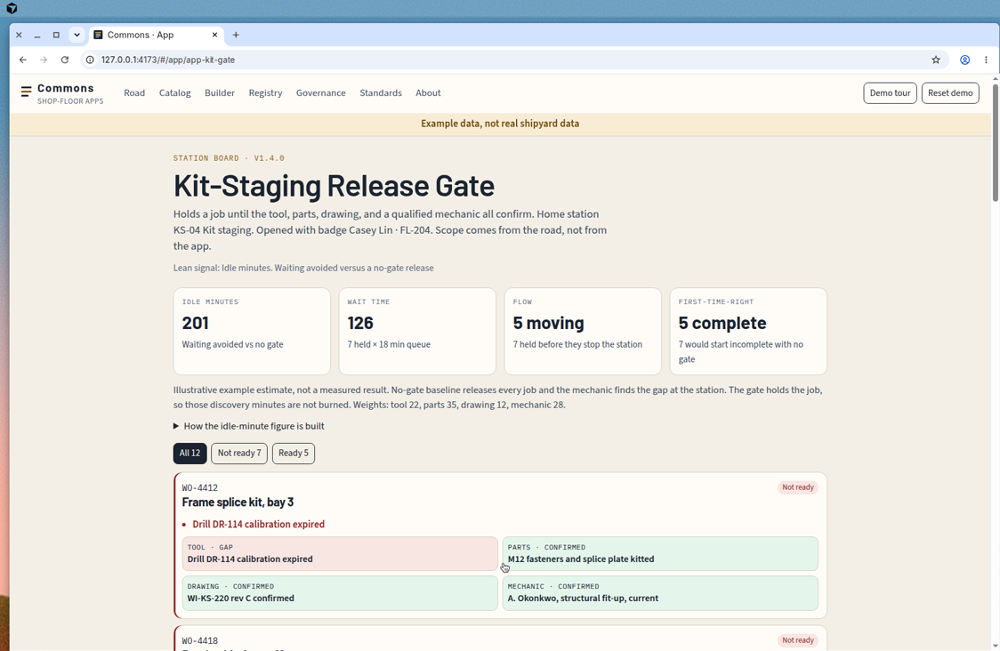
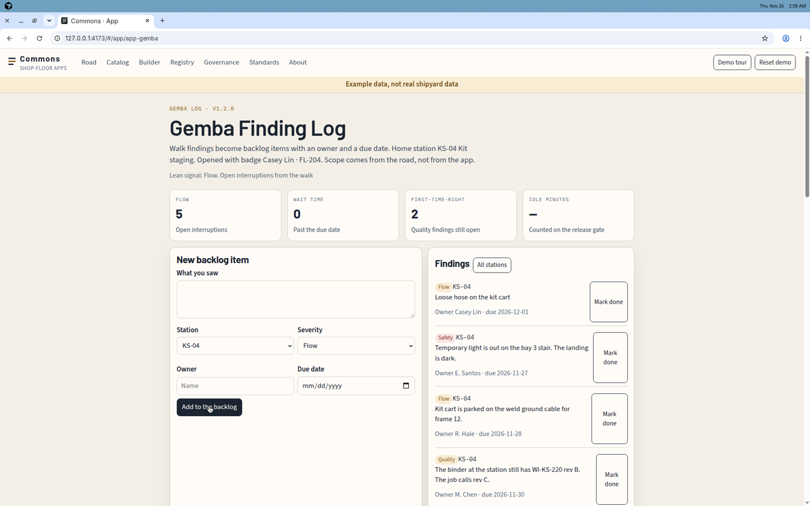
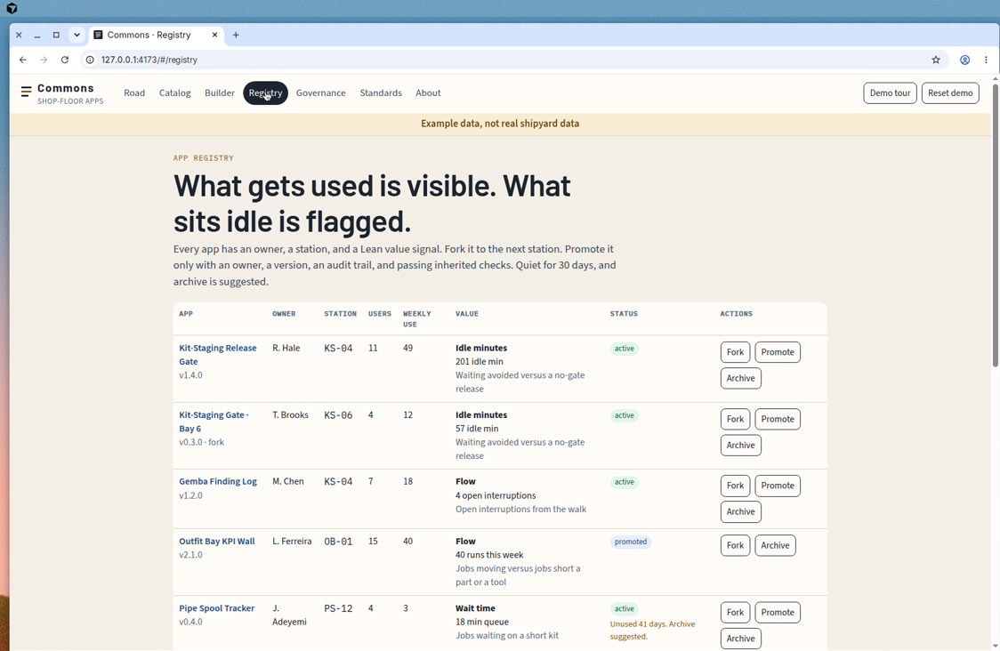
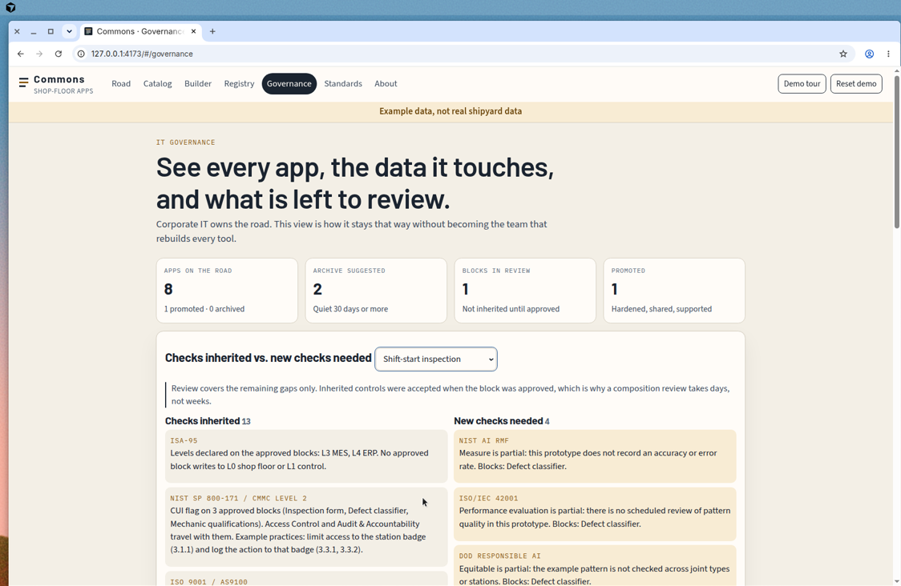
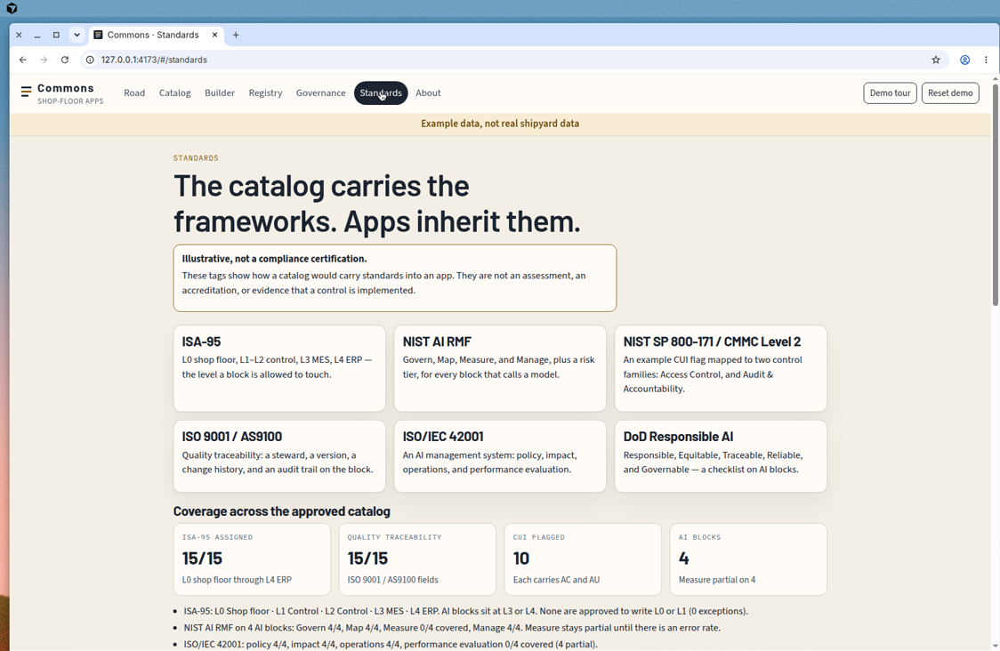

# Shop-floor app commons

A public prototype of a governed shop-floor app commons: floor teams build on a paved road IT owns, and the things that get used are promoted.

**Live demo:** https://zionxai5000.github.io/shopfloor-app-commons/

**Example data, not real shipyard data.** Standards tags are **illustrative, not a compliance certification.**

## The problem

Floor teams can assemble a tool in an afternoon. Most of those tools never share a definition of a job, a tool, or a person. They spend model tokens, they diverge, and they die when the author rotates off the station. Corporate IT still owns identity, data, and cost, but cannot see the work.

## The idea

Give the floor a catalog of approved blocks and a road those blocks already run on.

- Let them build, from a preset or from a sentence.
- Register every app with an owner, a station, and a Lean value signal.
- Promote what should be supported. Archive what has been quiet for 30 days.
- IT reviews the composition, not a blank sheet, because checks are inherited from blocks that were already approved. That is why review is days, not weeks.

## What you can walk through

1. **Paved road.** Identity, a governed ontology (people, tools, materials, parts, jobs, stations), models and token budgets, logging and cost. Every app sits on it.
2. **Block catalog.** Fifteen approved blocks across data connectors, AI patterns, and UI templates, plus one waiting in review. Each has an owner, a version, approval status, and a used-by count.
3. **Builder.** Presets, or a blank prompt such as “show me which jobs at my station are missing parts or tools.” Default matching is deterministic and explains why each block was chosen. Optional Live AI mode sends the prompt to an OpenAI-compatible endpoint. The key stays in the tab’s session storage and is never written into the demo data.
4. **Running apps.** The Kit-Staging Release Gate holds about a dozen jobs. A job is Ready only when the tool is calibrated, fasteners and parts are kitted, the drawing is confirmed, and a qualified mechanic is assigned. Otherwise it names the exact gap, for example “Drill DR-114 calibration expired.” Toggles clear the gap. Idle minutes, wait time, flow, and first-time-right are shown against a no-gate baseline as an illustrative example estimate. A Gemba finding log turns a walk note into a backlog item with an owner and a due date.
5. **Publish as a block.** A combination can be submitted for review and then appears in the catalog with you as owner. It is not inherited until IT approves it.
6. **Registry.** Owner, station, users, weekly use, and a Lean value metric. Fork to another station, promote, or archive. Apps unused 30 days or more are flagged. Lineage shows forks and contributions.
7. **IT governance.** Every app, the data and blocks it touches, token spend by team, the approval queue, promoted and archived counts, and checks inherited versus new checks needed.
8. **Standards.** One line each for ISA-95, NIST AI RMF, NIST SP 800-171 / CMMC Level 2, ISO 9001 / AS9100, ISO/IEC 42001, and DoD Responsible AI, plus coverage across the catalog.
9. **Demo tour.** Five steps: prompt, blocks, the running gate, registry, IT view.

State lives in `localStorage`. **Reset demo** restores the example data. There is no login and no server.

## Standards carried on each block

| Framework | What the prototype shows |
| --- | --- |
| ISA-95 | L0 shop floor, L1–L2 control, L3 MES, L4 ERP. Approved blocks do not write L0 or L1. |
| NIST AI RMF | Govern, Map, Measure, Manage, and a risk tier on AI blocks. Measure is partial: there is no error rate here. |
| NIST SP 800-171 / CMMC Level 2 | A CUI flag mapped to two example families: Access Control and Audit & Accountability. |
| ISO 9001 / AS9100 | Owner, version, change history, and an audit trail. |
| ISO/IEC 42001 | Policy, impact, operations, and performance evaluation on AI blocks. |
| DoD Responsible AI | Responsible, Equitable, Traceable, Reliable, Governable. |

Promotion requires an owner, a version, an audit trail, and passing inherited checks. Apps that include an AI block with an open Measure or Reliable item cannot be promoted until that gap is closed. That behavior is part of the demo, not an assessment.

## Run locally

```bash
npm install
npm run check
npm run dev
```

Open the URL Vite prints (the site uses relative asset paths, so the dev server root is correct).

```bash
npm run build
npm run preview
```

## Screenshots

The shots below are from the running prototype.

















## Prototype limits

This is a static walkthrough. Figures, control tags, and token costs are example estimates. Nothing here certifies a control, a person, or a yard.
